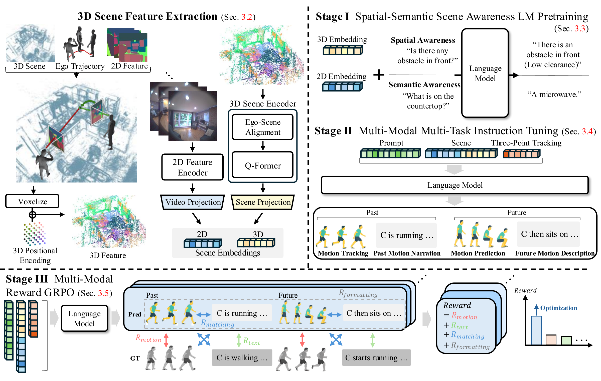

<div align="center">

# Official repo for Ego3DLM
**Ego3DLM: Ego-Human Motion Prediction with 3D-Aware LLM (ECCV 2026)**

[Project Page](https://jaewoo97.github.io/Ego3DLM/) | [Paper](https://jaewoo97.github.io/assets/ECCV_2026_Ego_human_Motion_Prediction_with_3D_aware_LLM__Arxiv_.pdf) | [Checkpoints & annotations](https://huggingface.co/datasets/jinyubae/Ego3DLM)



</div>

## Overview

Given **three-point tracking**, **3D scene features**, and **egocentric video**,
Ego3DLM decodes *past pose*, *future pose*, *past narration*, and *future narration*
in a **single autoregressive pass**. By grounding the predicted poses and descriptions
in one another, it enforces cross-modal and temporal consistency.

We adopt a **three-stage training scheme** on top of a frozen motion tokenizer:

- **Stage I — Spatial-Semantic Scene Awareness Pretraining** on semantic scene QA and spatial (obstacle / free-space) QA
- **Stage II — Multi-Modal Multi-Task Instruction Tuning** over all four outputs in a single pass
- **Stage III — Multi-Modal Reward GRPO** with intra- and inter-modal rewards that directly optimize pose–language fidelity

Experiments on the **[Nymeria](https://www.projectaria.com/datasets/nymeria/)** benchmark demonstrate
**state-of-the-art** performance on future pose prediction, past motion tracking and language description.

## 0. News
- **June, 2026** — Ego3DLM is accepted to **ECCV 2026**.
- **October, 2026** — Data preprocessing code, data splits, scene QA / spatial labels and the checkpoints are released.

## 1. Environment Setup
Tested with Python 3.11, CUDA 11.8, PyTorch 2.0.0, Transformers 4.46.3, PyTorch-Lightning 2.0.0.

```bash
conda create -n ego3dlm python=3.11 -y
conda activate ego3dlm
pip install -r requirements-freeze.txt
pip install gdown   # used by prepare/download_glove.sh
python -m spacy download en_core_web_sm
```

The code reads everything relative to the repository root. Create (or symlink) the following folders:

```
checkpoints/       # released / trained checkpoints and the text-motion evaluator
datasets/          # processed data (datasets/ego3dlm)
deps/              # GloVe word vectors used by the text-motion evaluator (deps/glove)
obstacle_labels/   # spatial-awareness labels (released)
```

```bash
bash prepare/download_glove.sh     # -> deps/glove (GloVe word vectors)
bash scripts/download_release.sh   # -> checkpoints/, datasets/ego3dlm/ (annotations), obstacle_labels/
```

GPT-2 medium (`openai-community/gpt2-medium`), BERT-base (Q-Former initialization) and
`sentence-transformers/all-MiniLM-L6-v2` (SBERT score) are downloaded automatically from Hugging Face.

## 2. Released Data and Checkpoints

`scripts/download_release.sh` downloads the following files from the Hugging Face Hub
([jinyubae/Ego3DLM](https://huggingface.co/datasets/jinyubae/Ego3DLM)). They are released under
[CC BY-NC 4.0](https://creativecommons.org/licenses/by-nc/4.0/); as they are derived from Nymeria, please also follow
its license and terms of use. The checkpoints hold the model weights only (no optimizer state).

| File | Location | Content |
|---|---|---|
| `stage3_grpo.ckpt` | `checkpoints/ego3dlm/` | Ego3DLM checkpoint |
| `stage0_pqvae.ckpt` | `checkpoints/ego3dlm/` | motion PQ-VAE tokenizer |
| `finest.tar` | `checkpoints/evaluator/`<br>`text_mot_match_trainset_only_len20/` | text–motion matching evaluator |
| `ego3dlm_annotations.tar.gz` | `datasets/ego3dlm/`, `obstacle_labels/` | data splits, sample-id mapping, narrations, semantic scene QA, spatial labels, normalization statistics and instruction templates |

The annotation bundle contains

```
datasets/ego3dlm/
├── data_split.json                    
├── train.txt / val.txt / test.txt     
├── train_val.txt
├── scene_info.txt                     
├── scene_info_with_scene_index.txt    
├── video_texts/<id>/qa_dataset.final.filtered.json   # semantic scene QA
├── texts/<id>.txt                     
├── mean.npy / std.npy / skel_offsets.npy             
├── tp_stats.pt / tp_rel_stats.pt / tp_cat_stats.pt   # three-point normalization statistics
└── template_*.json                    # instruction templates
obstacle_labels/<id>.txt               # spatial QA labels
```

The motion, video and 3D scene features are derived from Nymeria and are produced with the code in
[`preprocess/`](preprocess/README.md). The full dataset folder looks like

```
datasets/ego3dlm/
├── new_joint_vecs/      # (T-1, 279) motion features            preprocess/motion
├── new_joints/          # (T, 23, 3) joints                      preprocess/motion
├── three_points/        # (T, 3, 4, 4) head / wrist poses        preprocess/motion
├── texts/               # narrations with POS tags               preprocess/motion
├── video_features/      # (10, 1408) EVA-ViT-g embeddings        preprocess/motion
├── 3d_features_scene/{voxelized_voxels,voxelized_features}/      preprocess/scene
├── global_head_poses/   # head poses in the scene voxel grid     preprocess/scene
├── TOKENS/              # PQ-VAE motion tokens                   scripts/tokenize_motion.py
└── ... (annotation bundle)
```

## 3. Data Preprocessing
See [`preprocess/README.md`](preprocess/README.md):

* **Motion representation** — 279-D motion features retargeted to a common skeleton and canonicalized to face +Z,
  three-point (head / wrists) poses in the same frame, narrations with POS tags, and EVA-ViT-g video embeddings.
* **3D scene features** — following 3D-LLM, dense 2D features (Mask2Former + EVA-ViT-g) are lifted onto the Nymeria
  point cloud with a best-view policy and voxelized; the head poses are expressed in the same voxel grid.
  The scene is aligned to the head pose of the last observed frame of each sample inside the model, and a Q-Former
  compresses it into 32 query tokens.
* **Spatial-awareness labels** — `python -m preprocess.parse_obstacle --all --out_dir obstacle_labels --workers 8`.
* **Motion tokens** — after Stage 0: `python -m scripts.tokenize_motion --cfg configs/ego3dlm/tokenize.yaml`.

## 4. Training
All stages are driven by the configs in `configs/ego3dlm/`. Outputs are written to `experiments/ego3dlm/<NAME>/`
(Stage 0: `experiments/motion_tokenizer/<NAME>/`); copy or symlink the selected checkpoint to the path the next stage expects (`checkpoints/ego3dlm/`).

| Stage | Config | Init from | Expected output |
|---|---|---|---|
| 0 | `stage0_pqvae.yaml` | – | `stage0_pqvae.ckpt` |
| I | `stage1_scene_pretrain.yaml` | GPT-2 medium | `stage1_scene_pretrain.ckpt` |
| II | `stage2_instruct.yaml` | Stage I | `stage2_instruct.ckpt` |
| III | `stage3_grpo.yaml` | Stage II (policy and reference) | `stage3_grpo.ckpt` |

```bash
# Stage 0 - motion PQ-VAE, then tokenize all motions into TOKENS/
python -m train_pqvae --cfg configs/ego3dlm/stage0_pqvae.yaml --nodebug
python -m scripts.tokenize_motion --cfg configs/ego3dlm/tokenize.yaml

# Stage I - scene QA (semantic) and obstacle QA (spatial)
python -m train --cfg configs/ego3dlm/stage1_scene_pretrain.yaml --nodebug

# Stage II - [spatial scene reasoning] -> [past & future motion] -> [past & future narration] in one pass
python -m train --cfg configs/ego3dlm/stage2_instruct.yaml --nodebug

# Stage III - GRPO
python -m train --cfg configs/ego3dlm/stage3_grpo.yaml --nodebug
```


## 5. Evaluation

```bash
python -m eval --cfg configs/ego3dlm/eval.yaml --nodebug
```

To evaluate a Stage I / II checkpoint instead, run `eval` with the corresponding stage config, point
`TRAIN.PRETRAINED` at the checkpoint and, for Stage II, set `TRAIN.LOAD_CKPT_WO_TP_ENC: False` (that flag only drops the
three-point encoder when Stage II is initialized from Stage I).

`eval.yaml` evaluates `checkpoints/ego3dlm/stage3_grpo.ckpt` on `test.txt` (the validation recordings). For every
sample the model draws 3 generations; motion metrics use the best of the 3 (3 modes), the narration metrics use the
narration of that generation, and FID / Diversity use all generations.


## Acknowledgements
This codebase builds on [MotionGPT](https://github.com/OpenMotionLab/MotionGPT),
[EgoLM](https://arxiv.org/abs/2409.18127), [3D-LLM](https://github.com/UMass-Embodied-AGI/3D-LLM)
and [LAVIS](https://github.com/salesforce/LAVIS). The data is derived from
[Nymeria](https://www.projectaria.com/datasets/nymeria/); please follow its license and terms of use.

## Citation
```bibtex
@inproceedings{bae2026ego3dlm,
  title     = {Ego-Human Motion Prediction with 3D-Aware LLM},
  author    = {Bae, Yujin and Jeong, Jaewoo and Kim, Hyeonseong and Yoon, Kuk-Jin},
  booktitle = {European Conference on Computer Vision (ECCV)},
  year      = {2026}
}
```
